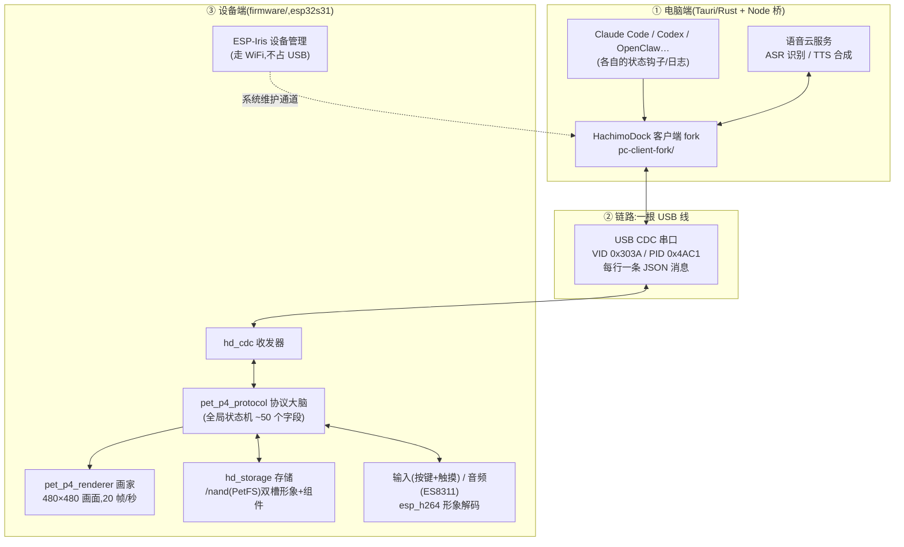
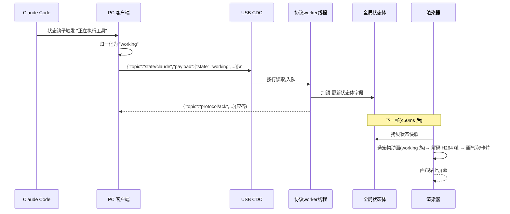

# esp-mosaico-HachimoDock

> 把你电脑里的 AI Agent「装进」桌面上的一台小方屏设备:Agent 在思考、干活、等你确认、
> 出错时,桌上的宠物屏幕会实时变脸、冒气泡、出声音——你也能按住它的键对它说话。

这是 [HachimoDock(哈基米机)](https://github.com/YizhengWw/HachimoDock) 在
[ESP-Mosaico](https://github.com/esp-mosaico) 开发板(乐鑫 esp32s31,480×480 正方形触摸屏)
上的完整移植。原项目跑在 ESP32-P4 + 定制硬件上;本仓库让它跑在 Mosaico 板上,
**电脑侧软件同样只需要一根 USB 线**,设备不需要入网。

```
你的电脑                                    桌面小方屏
┌─────────────────────┐    USB 数据线    ┌──────────────────┐
│ Claude Code / Codex │                  │  🐶 宠物动画      │
│   ↓(状态钩子)       │   JSON 文本行    │  💬 会话气泡      │
│ HachimoDock 客户端  │ ══════════════▶ │  🎮 小组件/小游戏  │
│  (本仓库 pc-client- │                  │  🎤 麦克风/喇叭   │
│   fork)            │ ◀══════════════  │  (按键/触摸回传)  │
└─────────────────────┘   按键/语音/事件 └──────────────────┘
```

> **许可证**:上游 HachimoDock 项目许可证(非商业、源码可得)继续适用于本仓库中移植的
> 上游代码(`firmware/main/pet/`、`pc-client-fork/`);本项目仅为个人非商业用途,
> 商业使用需取得上游权利人书面授权。cJSON / lvgl 为 MIT。

---

## 目录

1. [它能干什么(用户视角)](#它能干什么用户视角)
2. [整体架构:三层一张图](#整体架构三层一张图)
3. [设备固件核心模块导览](#设备固件核心模块导览)
4. [五条关键流程走读](#五条关键流程走读)
5. [PC 客户端核心模块](#pc-客户端核心模块)
6. [ESP-Mosaico 平台特有概念(必读)](#esp-mosaico-平台特有概念必读)
7. [目录结构注释版](#目录结构注释版)
8. [构建与运行](#构建与运行)
9. [验证状态与已知边界](#验证状态与已知边界)
10. [常见问题](#常见问题)

---

## 它能干什么(用户视角)

| 场景 | 设备上的表现 |
|---|---|
| Agent 正在写代码 | 宠物播放「工作中」动画(吐舌头/敲键盘),顶部状态灯变绿 |
| Agent 需要你确认 | 宠物变「等待」表情,屏幕出现黄色提示条 |
| 同时开了 3 个任务 | 屏幕下方出现 3 张会话卡片,实时刷新各自状态;完成的卡保留 60 秒再消失 |
| 构建失败 | 宠物变「出错」表情 + 红色提示,音箱播放出错提示音 |
| 按住宠物键说话 | 设备录音上传电脑 → 电脑语音识别 → 文字注入当前 Agent 对话框 |
| 闲下来 | 内置小游戏/工具:贪吃蛇、敲木鱼、番茄钟、自选股行情……还能用 AI 生成新组件 |

## 整体架构:三层一张图



一句话:**电脑把「Agent 状态」变成 JSON 文本,USB 像聊天一样一行行发给设备;设备维护一个
实时状态体,画家模块每 50ms 把它画到屏幕上。反方向,按键/触摸/语音也变成 JSON 传回电脑。**

## 设备固件核心模块导览

固件在 `firmware/` 下。真正要读懂的只有 4 个「新写的」接线文件 + 5 个「移植的」核心模块:

### 新写的接线层(本项目原创,理解架构从这里开始)

| 文件 | 角色 | 一句话职责 |
|---|---|---|
| `main/main.c` | **大门** | 把控制权交给 Mosaico 游戏引擎(它管屏幕/触摸/健康验收),自己只接 AI 键事件 |
| `main/hd_pet.c` | **总指挥** | 开机初始化全部模块;每帧调用一次「处理状态 + 渲染」;维护协议工作队列(收到的消息排队串行处理,避免并发打架) |
| `main/hd_cdc.c` | **USB 话筒** | 把设备伪装成一个串口(CDC),收电脑发来的每一行 JSON,发回去每一行应答 |
| `main/hd_storage.c` | **仓库管理员** | 开机挂载 NAND 闪存为 `/nand` 文件系统;实现形象包「双槽」写入(先写完整、后原子切换,断电不坏) |

### 移植的核心模块(`firmware/main/pet/`,来自上游,约 2.6 万行)

| 模块 | 角色 | 通俗解释 |
|---|---|---|
| `pet_p4_protocol.c` | **协议大脑** | 认识电脑发来的每一种消息(约 40 个 topic:状态/气泡/按键配置/组件/音频/形象传输…)。它唯一有权修改「全局状态体」——一个约 50 字段的大结构体(当前 Agent、状态、台词、8 张会话卡、字幕历史…),相当于设备的「世界内存」 |
| `pet_p4_renderer.c` | **画家**(4563 行) | 每帧读一份状态快照,画宠物动画帧、气泡、会话卡、组件中心页…全部自己用软光栅画进一块 480×480 的 RGB565 画布,再整幅贴上屏幕 |
| `pet_p4_font_cn.c` | **中文字库**(15 万行) | MiSans 16px 点阵数据,让上面所有文字能显示中文 |
| `pet_p4_miniapp.c` + `pet_p4_game.c` | **组件运行时** | 设备上的「小程序引擎」。组件是**纯 JSON 声明**(状态机 ≤6 态 / 小游戏 ≤12 实体),不含任何可执行代码——AI 生成、电脑校验、下发即用,设备端怎么都不会执行恶意代码 |
| `pet_p4_input.c` / `pet_p4_touch.c` | **输入翻译官** | 把 AI/Boot 两枚实体键和触摸手势(点/长按/四向滑动)翻译成上游的 12 种手势名(事件名不变,PC 端按键配置界面零改动) |
| `pet_p4_audio.c` | **音响师** | 麦克风采集 16kHz PCM 按帧上传(语音输入);接收电脑下发的 PCM 播放(TTS/音乐/提示音) |
| `pet_p4_ota_stub.c` | **门卫** | 电脑若试图直接给设备刷固件,统一拒绝——见下文「平台特有概念」 |

> 其余 `pet_p4_*` 文件(行为选择器/统计/视图模型/媒体/乐器…)都是上述模块的配角,
> 名称与职责一一对应上游,不再展开。`host_only/` 与 `pet_p4_platform.h` 是让同一份代码
> 能在电脑模拟器里编译运行的小垫片,设备上不参与工作。

## 五条关键流程走读

### 流程 1:开机(到宠物出现为止)

```
上电
 → 引导程序检查:按住 AI 键? → 是:进 Vibe Mode(救援系统,见「平台概念」)
                              → 否:启动 ota_0 里的本应用
 → main.c 把控制权交给引擎,引擎依次:
    1. 启动 ESP-Iris(设备管理服务,走 WiFi)
    2. 点亮屏幕、启动触摸轮询
    3. 调 hd_pet_start():
       挂载 /nand → 初始化诊断 → 创建协议状态体 → 启动协议工作线程
       → 加载组件目录 → 解析形象清单 → 初始化输入/触摸/渲染器/音频
       → 启动 USB CDC → 主动广播 hello(自我介绍)
    4. 画出第一帧(黑屏+气泡占位)→ 标记固件「健康」(OTA 验收点)
 → 主循环:每秒 20 帧,每帧 = 处理状态(超时清理/组件tick/输入) + 渲染
```

### 流程 2:一条 Agent 状态的完整旅程(核心中的核心)



### 流程 3:形象同步(把一段狗视频变成宠物动画)

1. 你在 PC 客户端选一个 MP4(或用 AI 生成);
2. 客户端用 FFmpeg 转码为设备档位(H.264 基线、480×480、15fps、每段 ≤225 帧);
3. 逐文件分块下发(`asset/begin → raw-chunk(二进制直传)→ commit`),设备边收边写
   `/nand` 的「待用槽」,每块带校验和,断点可重传;
4. 全部完成后写「目录头」并**原子切换**活动槽——中途断电只会丢弃半个包,旧形象不受影响;
5. 设备回 `hello` 能力里带上新形象包 ID,电脑记住下次免重传。

### 流程 4:安装一个小组件(AI 生成 → 设备可玩)

```
你在 Claude Code 里说:"用 petui 技能给我做个喝水提醒"
 → AI 生成 clawpkg 包(纯 JSON:界面状态机 + 按键绑定 + 预编译精灵图)
 → PC 校验(结构/字节预算/输入白名单),拒绝任何可执行代码
 → widget/begin → widget/chunk(逐文件 base64)→ widget/commit
 → 设备落盘 /nand/pet,目录双快照原子切换
 → 屏幕左右滑进「组件中心」即可打开;全局键永远是返回出口
```

### 流程 5:语音输入(对宠物说话 → 注入 Agent)

```
长按宠物键 → 设备开始录音(16kHz,20ms 一帧,base64 编码上行)
 → PC 收齐后调云端 ASR 转文字
 → 按当前气泡对应的 Agent 注入:
     · Claude/Codex:直接后台续会话,或写入其输入框为草稿待你确认
 → 宠物播放确认动画;Agent 回复文本下发为字幕/气泡
(TTS 回放走 audio/play_chunk,支持边说边打断)
```

## PC 客户端核心模块

`pc-client-fork/` 是上游客户端的最小改动版(改动清单见其 `README-MOSAICO.md`):

| 模块 | 职责 | 本 fork 改了什么 |
|---|---|---|
| Agent 检测层 | 通过各 Agent 的状态钩子/会话日志识别「谁在干活、什么状态」 | 不变 |
| `usb_serial.rs` | 串口发现/握手/全部协议事务(状态/形象/组件/音频/固件) | 新增 `esp-mosaico` runtime 识别;CDC 端口豁免 CH343 桥的 64 字节限速;480×480 转码档(环境变量 `HACHIMO_MOSAICO_GEOMETRY=1`) |
| `clawpkg.rs` | 组件包校验(字节预算/输入白名单/禁可执行) | 不变 |
| 桥(Node 侧车) | 安装各 Agent 的状态钩子、路由语音注入 | 不变 |
| 固件升级入口 | — | **对 esp-mosaico 明确拒绝**并提示走 `mosaico.py` |

## ESP-Mosaico 平台特有概念(必读)

如果你只熟悉原版 HachimoDock,这一节是本移植与它的**全部差异根源**:

1. **恢复契约(最重要)**:ESP-Mosaico 设备的固件升级**永远**由平台工具
   `python mosaico.py iris system-update` 完成,应用自己不许碰闪存固件区。
   所以设备把上游的 USB 刷机协议(`firmware/*` 消息)全部改为「礼貌拒绝」。
   好处:刷坏了永远能救,且应用更新与形象/组件互不干扰。
2. **USB 归属例外**:原版设备的 USB 同时用于「宠物聊天」和「系统维护」;
   本移植把高速 USB 完全给了宠物链路(更低延迟),系统维护走 WiFi 上的
   ESP-Iris 通道。救援因此有三条路(按成本从低到高):
   - WiFi 在线 → `mosaico.py iris ...`(TCP);
   - 断电按住 **AI 键**上电 → 进入 **Vibe Mode**(出厂救援系统,它会重新接管 USB);
   - 断电按住 **Boot 键**上电 → ROM 底层模式,`mosaico.py recover` 重刷。
3. **存储**:不用自定义分区。形象包、组件、提示音全住 `/nand`(≈121MB 的 NAND 文件系统),
   应用分区固定 14.6MB——所以「只改代码」的升级可以走更轻的 `iris app-update`。
4. **输入重映射**(硬件差异,协议不变):原版 3 键 + 摇杆 → 本板 2 键 + 触摸:

   | 原版手势 | 本板操作 |
   |---|---|
   | SW1 短/长按 | **AI 键**短/长按 |
   | SW2 短/长按 | **Boot 键**短/长按(仅运行期;开机时它保留给 ROM 模式) |
   | 摇杆四向 / SW3 / 旋钮 | 屏幕四向**滑动** / **长按** / 左右滑动 |
5. **方形屏**:480×480(原版 480×640 竖屏)。渲染器删除了原版的「横竖屏旋转」加速路径,
   布局坐标已重映射;形象转码也改为方形档。

## 目录结构注释版

```
esp-mosaico-HachimoDock/
├── firmware/                    # 设备固件工程(须放回 ESP-Mosaico 工作区构建)
│   ├── main/
│   │   ├── main.c               # 入口:交给引擎,接 AI 键
│   │   ├── hd_pet.c/.h          # 总指挥:生命周期 + 主循环 + 协议队列
│   │   ├── hd_cdc.c/.h          # USB CDC 宠物链路
│   │   ├── hd_storage.c/.h      # /nand 挂载 + 形象双槽后端
│   │   ├── assets/              # 内嵌资产:敲木鱼音源 + 3 个状态提示音
│   │   └── pet/                 # 上游移植层(45 个文件)
│   │       ├── pet_p4_protocol.c/.h   # ★ 协议大脑 + 全局状态体
│   │       ├── pet_p4_renderer.c/.h   # ★ 画家(480×480 手术版)
│   │       ├── pet_p4_font_cn.c       # ★ 中文字库
│   │       ├── pet_p4_miniapp.c / pet_p4_game.c  # ★ 组件运行时/小游戏引擎
│   │       ├── pet_p4_input*.c / pet_p4_touch*.c # 输入(注入式适配)
│   │       ├── pet_p4_audio.c         # ES8311 音频
│   │       ├── pet_p4_ota_stub.c      # firmware topic 拒绝门卫
│   │       ├── pet_p4_platform.h      # 宿主/设备编译分界垫片
│   │       └── host_only/             # 宿主模拟器专用(cJSON/字体引擎/base64)
│   ├── host_tests/              # 4 套纯 C 逻辑回归(w64devkit gcc 一键跑)
│   ├── game.sim.json            # 模拟器源清单
│   ├── build_hachimo.ps1        # 一键构建(自动处理 ninja 缓存坑)
│   └── partitions.csv           # 分区表(平台标准布局,应用区 14.6MB)
├── pc-client-fork/              # PC 客户端 fork(含 README-MOSAICO.md 改动清单)
└── docs/port-plan.md            # 移植方案全文:硬件对位/决策依据/全部坑位记录
```

## 构建与运行

**设备固件**(需 ESP-Mosaico 工作区 + 固定 ESP-IDF,详见 `firmware/README.md`):

```sh
# 把 firmware/ 放入 <esp-mosaico-workspace>/projects/hachimo_pet 后:
powershell -ExecutionPolicy Bypass -File projects/hachimo_pet/build_hachimo.ps1
# 产物 build/hachimo_pet.bin(实测 3.32MB)
```

**模拟器**(无需任何硬件,30 秒看效果):

```sh
python mosaico.py game sim --project projects/hachimo_pet        # 交互窗口
python mosaico.py game sim --project projects/hachimo_pet --headless --frames 40
```

**宿主逻辑单测**:

```sh
bash projects/hachimo_pet/host_tests/run_host_tests.sh
```

**PC 客户端**(与上游一致):

```sh
cd pc-client-fork && npm install && npm run tauri dev
# 连接设备前设置方形屏转码档:
set HACHIMO_MOSAICO_GEOMETRY=1
```

## 验证状态与已知边界

| 项 | 状态 |
|---|---|
| 设备固件构建 | ✅ 全绿(bin 3,318,608 字节,应用区余量 11MB+) |
| 模拟器 | ✅ 40 帧全绿(Agent 状态轮播 + 双会话卡 + 中文渲染) |
| 宿主单测 | ✅ 4 套全绿(输入核心/游戏引擎/对话字幕/实时数据) |
| PC fork Rust 编译 | ⏳ patch 均为机械替换且过唯一性断言,但开发机无 cargo,首 build 时如有字段出入按编译器提示微调 |
| 真机验收 | ⏳ 待设备(三重恢复路径 / CDC 握手 / 形象与组件下发 / 语音) |
| 已知边界 | AEC 回声消除暂走半双工(上游同款降级路径);原生 USB bulk 通道未启用(CDC 已够) |

## 常见问题

**Q:设备需要联网吗?**
宠物链路本身不需要(纯 USB)。需要联网的是:ESP-Iris 系统维护通道(WiFi)、电脑侧的
语音识别/生成服务。空闲时设备完全离线也能当闹钟/小游戏机用。

**Q:和原版 HachimoDock 硬件什么关系?**
零关系——这是把它的软件搬到另一块板子。原版协议(schema 7)与 PC 客户端完全复用,
所以两边生态(AI 生成组件、社区形象)互通。

**Q:为什么电脑不能直接刷设备固件了?**
见「平台特有概念」第 1 条:ESP-Mosaico 的恢复契约把刷机权收归平台工具,防止应用
刷坏自己变砖。用 `mosaico.py iris system-update` 一样简单,且多了断电保护与回滚。

**Q:能显示视频吗?**
能——「形象」就是一组合规转码的 H.264 短视频(每个动作一段,≤225 帧),设备用
esp_h264 软件解码逐帧播放;JPEG 硬解作为旧格式兜底。

**Q:想自己加个桌面组件怎么办?**
对 Claude Code/Codex 说「用 petui 技能做一个 XXX」,AI 生成 → 客户端校验 →
组件中心同步即可。组件是声明式 JSON,不会也不可能有病毒行为。

---

*移植实施记录、逐模块工作量与全部踩坑细节见 [docs/port-plan.md](docs/port-plan.md)。*
